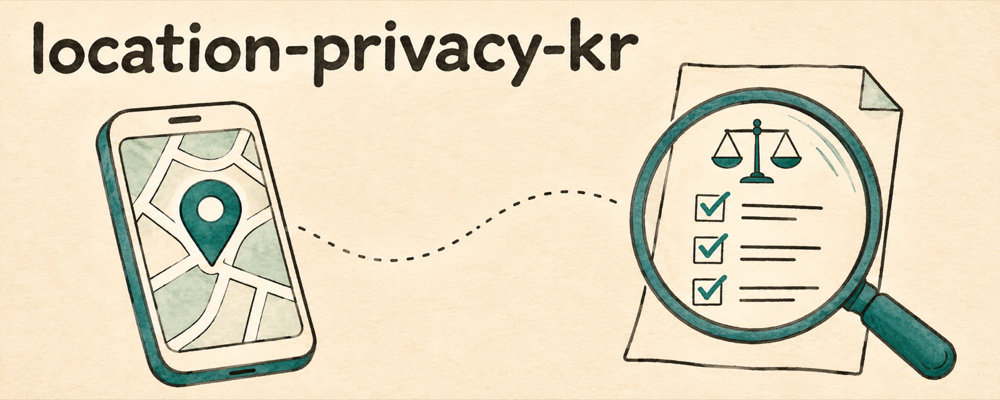

<p align="center">
  
</p>

<p align="center">
  <a href="README.md">한국어</a> · <b>English</b>
</p>

# location-privacy-kr

**Find out whether your app's location handling, terms, and privacy policy hold up under Korea's Location Information Act, with file:line evidence and fixes.**

## What it is

An agent skill for Claude Code and Codex. It reads your code and your legal documents together, checks them against Korea's Location Information Act (위치정보법) and Personal Information Protection Act (개인정보보호법), and writes a report. In fix mode it patches the code and drafts the missing documents.

## Why it exists

Five open-source privacy skills were installed and run on two real apps (a production mobile app and the open-source OwnTracks location-sharing app). None of them covered the Location Information Act: separate location-terms consent, automatic use/provision records, the right to pause, immediate deletion, third-party notice, and the under-14 rules. They also judged documents without reading the code. One app declared "Always" location strings it never requested. Another sent precise background location to a server while its privacy manifest declared no collected data. A third had a policy about website cookies instead of the app. Some marked server-side items they could not see as passed or failed.

This skill puts the code first: it builds a map of where location is collected, sent, stored and deleted, then checks every document against that map. Anything it cannot see is reported as "확인 불가" (not verified), never as passed.

## What it does

| Mode | You say | You get |
|---|---|---|
| `audit` (default) | "위치정보법 준수 점검해줘" | Report with applicability call, location data map, findings with evidence. Target code untouched |
| `fix` | "고쳐줘", "개선해줘" | Audit, then code fixes in your repo and draft terms and privacy-policy sections, then a re-check |
| `docs` | a terms or policy URL or file | Checklist results for the documents only |
| `prep` | "실태점검 준비" | Audit plus an evidence list, internal policy outline, and a record-table schema for regulator inspections |

Checklists cover location-based service terms (T1-T22), the privacy policy (P1-P20) and personal location information items (L1-L7), consent and rights, and safeguards. Severity follows the type of sanction under Korean law (criminal, administrative fine, advisory), not GDPR tiers. Where the two sources disagreed, 17 rulings are written down in [`conflicts.md`](skills/location-privacy-kr/references/conflicts.md).

## Example

Input, on the open-source [owntracks/android](https://github.com/owntracks/android) and [owntracks/ios](https://github.com/owntracks/ios) repos:

```text
/location-privacy-kr audit — 이 앱을 한국에 출시한다고 가정하고 위치정보법·개인정보보호법 준수 점검해줘
```

Output (summary excerpt from the actual run, 2026-11-13):

```text
적용 판정
- 위치정보 처리: 있음 (FusedLocationProvider 연속 측위 GMSLocationProviderClient.kt:91,
  지오펜스 GMSGeofencingClient.kt:29, iOS startUpdatingLocation/startMonitoringVisits LocationManager.m:428,446)
- 개인위치정보: 해당 (좌표 + tid/deviceId 토픽과 함께 서버 전송, LocationProcessor.kt:246-264).
  기본 extendedData=true로 Wi-Fi SSID/BSSID도 함께 전송 (DefaultsProvider.kt:63)
- 사업자 유형(추정): 판단 필요. 앱 기본 서버 없음 (DefaultsProvider.kt:36,80) → 셀프호스팅 구조
- 제3자 제공: 있음(조건부) — 친구 위치 구독 기본 켜짐 (DefaultsProvider.kt:72)

| 치명 1 (조건부) | 높음 5 (조건부) | 보통 5 | 낮음 2 | 확인 불가 8 |

LP-05 높음(조건부) 친구 위치 구독으로 위치가 다른 사용자에게 제공되나
      제3자 제공 고지·별도 동의·사후통보 장치 없음 | 위치정보법 제19조 제2항-제4항 | F6
```

## Requirements

- Claude Code, Codex, or another agent that loads Agent Skills
- `git` and `curl` (to search the repo and fetch published documents)

## Install

### Claude Code (plugin)

```text
/plugin marketplace add nathankim0/location-privacy-kr
/plugin install location-privacy-kr@location-privacy-kr
```

### Claude Code or Codex (manual)

```bash
git clone https://github.com/nathankim0/location-privacy-kr.git
cp -R location-privacy-kr/skills/location-privacy-kr ~/.claude/skills/location-privacy-kr   # Claude Code
cp -R location-privacy-kr/skills/location-privacy-kr ~/.codex/skills/location-privacy-kr    # Codex
```

### Any agent that supports Agent Skills

```bash
npx skills add nathankim0/location-privacy-kr
```

## Usage

```text
/location-privacy-kr                       audit the current repo
/location-privacy-kr fix                   audit, then fix code and draft documents
/location-privacy-kr docs https://example.com/terms/location
/location-privacy-kr prep                  prepare for a regulator inspection
```

In Codex, ask in plain words ("위치정보법 기준으로 이 저장소 점검해줘"); the skill triggers from its description.

The skill never publishes documents, deploys, files registrations, or touches production data. It is not legal advice; whether you must register or file as a location business is reported as "판단 필요" with the reasons.

## Repository layout

```text
skills/location-privacy-kr/SKILL.md            the workflow
skills/location-privacy-kr/references/
  applicability.md                             is it location data, which operator type
  code-audit.md                                building the location data map from code
  terms-checklist.md                           location-based service terms T1-T22
  privacy-policy-checklist.md                  privacy policy P1-P20, location items L1-L7
  consent-and-rights.md                        consent, withdrawal, pause, deletion, notice, minors
  safeguards.md                                records, access logs, controls, inspection prep
  penalties.md                                 severity and sanctions
  fix-patterns.md                              code fixes and document skeletons
  report-template.md                           report format
  conflicts.md                                 rulings where source skills disagreed
.claude-plugin/                                Claude Code plugin and marketplace manifests
```

## Credits

Built by running and comparing five open-source privacy skills. See [ATTRIBUTIONS.md](ATTRIBUTIONS.md). The legal checklists paraphrase the statutes, informed by the public 2026 training material on location information protection from the Korea Media and Communications Commission and KISA.

## License

[MIT](LICENSE)
